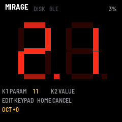

# Mirage for the M-VAVE FM-1

An Ensoniq Mirage sampler (1984) as custom firmware for the **M-VAVE FM-1**. Like
[mirage-remake](https://github.com/leonardolopezchavira/mirage-remake) on the Mac, it does not imitate the Mirage:
it emulates its hardware and runs the **original boot ROM and operating system**, so the parameters, the keypad,
voice allocation, envelopes, the LFO, MIDI and disk handling are all Ensoniq's own code.

> **Unofficial project.** Not affiliated with Ensoniq, its successors or M-VAVE.



## Status

Early: the scaffold and the emulator core. See [docs/PLAN.md](docs/PLAN.md) for the phases.

| | |
| --- | --- |
| Emulator core in C (`src/mirage/`) | **done**, bit-exact with mirage-remake |
| Built-in OS 3.2 disk (piano, voices, strings), packed for the FM-1's flash | **done** |
| FM-1 app: keys, MIDI in, the display, the keypad, K1/K2 editing | first pass, runs in the host simulator |
| On the FM-1 itself | 0.1.0 measured 228 % of the CPU; 0.3.0 adds a CPU-load guard and a safe start. Read [docs/SAFETY.md](docs/SAFETY.md) before installing |

## How it works

| Part | Chip | Here |
| --- | --- | --- |
| CPU | Motorola 6809E, 2 MHz | `src/mirage/cpu6809*.h`, cycle-counted |
| Timers, keypad, display | MOS 6522 VIA | `src/mirage/via6522*.h` |
| MIDI | Motorola 6850 ACIA | `src/mirage/acia6850.h`, paced at 31,250 baud |
| Floppy | WD1772, 3.5" drive | `src/mirage/wd1772.h`, the disk reached through `mirage_disk_t` |
| Sound | Ensoniq ES5503 DOC, 32 oscillators, 128 KB sample RAM | `src/mirage/es5503.h` |
| Filters | 8 x Curtis CEM3328 4-pole low-pass | `src/mirage/cem3328.h` |

`src/mirage/` is portable C99: no allocation, no OS calls, and on the FM-1 single precision through fm1-base's
`fastmath.h` (the AC79 has a single-precision FPU and no libm). Built with `MIRAGE_DOUBLE` it does exactly what
mirage-remake's C++ does, and `tests/oracle.cpp` checks that, sample for sample: power-on with the ROM's filter
tuning, the OS load, a chord, keypad edits, the wheels, a sample recorded from the audio input, and a save to disk.

The OS 3.2 disk is built into the firmware packed (`tools/pack_disk.py`: each track on its own, a predictor and Rice
codes, 450 KB to 253 KB); `src/mirage/packed_disk.c` decodes the track the OS asks for.

## On the FM-1 (for now)

- **Keys** play the Mirage (with velocity), **OCT- / OCT+** move them by octaves. MIDI in from USB, the TRS jack and
  Bluetooth goes to the Mirage as it is (OS 3.2 listens in omni).
- **The display** is the Mirage's two digits, each segment as bright as the multiplex lights it.
- **K1** picks a parameter number; when it rests, PARAM, the two digits and VALUE go to the Mirage. **K2** steps the
  value down and up. **HOME** is CANCEL.
- **EDIT** turns the keys into the Mirage's keypad: the white keys are 1-9, 0, PARAM, VALUE, down, up, CANCEL, ENTER;
  the black keys LOAD LOWER, LOAD UPPER, SAMPLE LOWER, SAMPLE UPPER, PLAY SEQ, REC SEQ, LOAD SEQ, SAVE SEQ.
- The built-in disk is read-only for now: LOAD LOWER/UPPER 1-3 load OS 3.2's six sounds.

## Building

Desktop (the core, its tools and tests):

```sh
git clone --recursive https://github.com/leonardolopezchavira/mirage-fm1
cmake -S mirage-fm1 -B build && cmake --build build && ctest --test-dir build
# the oracle, against a mirage-remake checkout:
cmake -S mirage-fm1 -B build -DMIRAGE_REMAKE_DIR=/path/to/mirage-remake && cmake --build build && ctest --test-dir build
./build/mirage_cli data/rom/mirage.bin disk data/disks/os32.img boot show key PARAM key 3 key 8 key VALUE show
```

The host simulator (fm1-base's; needs Pillow):

```sh
python3 fm1/base/tools/build.py app --host
app/build/host/mirage_host app/tests/basic.txt app/build/host
```

The firmware is built by the `firmware` workflow with JieLi's toolchain (the shared
[fm1-build](https://github.com/zvenson/fm1-build) workflow), as sq80-fm1's is: `python3 fm1/base/tools/build.py app`.

## Layout

- `src/mirage/`: the emulator (MIT), the same source for the desktop, the simulator and the FM-1
- `app/`: the FM-1 app on fm1-base; `app/mirage` links to `src/mirage`; `app/data/` the built-in ROM and disk
- `fm1/base`: [fm1-base](https://github.com/charlesvestal/fm1-base) (a submodule, MPL-2.0)
- `tools/`: the disk packer, the headless CLI
- `tests/`: the core test, the pack test, the oracle against mirage-remake
- `data/`: the Mirage's boot ROM and the OS 3.2 disk image (Ensoniq's: see LICENSE.md)

## Credits

- The emulator: a C port of [mirage-remake](https://github.com/leonardolopezchavira/mirage-remake)'s.
- Memory map, I/O layout and ES5503 details: MAME's `enmirage.cpp` and `es5503.cpp` (R. Belmont, tim lindner;
  BSD-3-Clause).
- ROM disassembly: Tim Victor, Gordon JC Pearce, and Alessandro Fasan's
  [AlfaSoniQMirage](https://github.com/alfa95139/AlfaSoniQMirage).
- Disk images: the [ZAPPPP/Mirage](https://github.com/ZAPPPP/Mirage) collection.
- The FM-1 platform: [fm1-base](https://github.com/charlesvestal/fm1-base) by Charles Vestal, on
  [felucca-bsp](https://github.com/hugelton/felucca-bsp).

Licences: [LICENSE.md](LICENSE.md) and [THIRD_PARTY_NOTICES.md](THIRD_PARTY_NOTICES.md).
